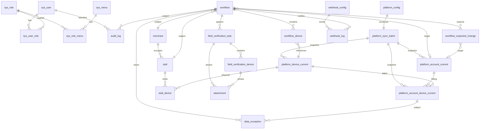

# ER 设计（第一阶段涉及表）

> 数据库：`mall_energy_management`，字符集 `utf8mb4`，排序 `utf8mb4_unicode_ci`。  
> 主键策略：自增 BIGINT（除审计/快照可考虑雪花）。  
> 时间字段：`created_at`, `updated_at` DATETIME(3)，均由 MyBatis-Plus 自动填充。

## Mermaid ER（核心实体）



## 表清单

### 系统 / 安全（V1）
| 表 | 说明 |
|---|---|
| `sys_user` | 用户 |
| `sys_role` | 角色（SUPER_ADMIN / SYSTEM_ADMIN / APPLICANT / DEVICE_VERIFIER / PLATFORM_OPERATOR / AUDITOR / VIEWER） |
| `sys_user_role` | 用户角色关联 |
| `sys_menu` | 菜单 |
| `sys_role_menu` | 角色菜单 |
| `audit_log` | 审计日志（operator, operation, business_type, business_id, before_data, after_data, ip, user_agent, created_at） |

### 源平台（V2）
| 表 | 说明 |
|---|---|
| `platform_config` | 源平台配置（id=1，唯一）。字段：platform_name, base_url, account_username, password_ciphertext, password_iv, space_id, enabled, auto_sync, sync_cron, connect_timeout_ms, last_connect_at, last_sync_at, last_sync_status, created_at, updated_at |
| `platform_sync_batch` | 同步批次（id, batch_no, started_at, completed_at, status, account_count, device_count, relation_count, error_message, trigger_type, trigger_user_id） |
| `platform_account_current` | 当前账户镜像（id, platform_account_id, account_number, account_name, merchant_code, merchant_code_source, merchant_code_match_status, user_name, contact_name, mobile_phone, balance, arrears, platform_status, source_space_id, sync_batch_id, last_synced_at, raw_json） |
| `platform_device_current` | 当前设备镜像 |
| `platform_account_device_current` | 当前账户设备关系 |
| `platform_account_snapshot` | 账户历史快照 |
| `platform_device_snapshot` | 设备历史快照 |
| `platform_account_device_snapshot` | 关系历史快照 |

### 铺位 / 商户（V3 + 后续）
| 表 | 说明 |
|---|---|
| `merchant` | 本地商户（id, merchant_code[unique], merchant_code_source, merchant_code_match_status, merchant_name, contact_name, contact_phone, source_platform_account_id, created_at, updated_at） |
| `stall` | 铺位（id, stall_code[unique], stall_name, floor_code, floor_name, area_name, area, business_type, business_category, status, remark） |
| `stall_device` | 铺位-设备关系（id, stall_id, platform_device_id, effective_from, effective_to, status, created_by, remark） |

### 流程（V4）
| 表 | 说明 |
|---|---|
| `workflow` | 流程主表（id, workflow_no, workflow_type, merchant_code, merchant_name, contact_name, contact_phone, stall_id, target_account_number, requested_billing_start_time, applicant_id, applicant_name, status, submitted_at, field_verified_at, waiting_platform_at, verified_at, completed_at, expected_account_action, remark, extra_data） |
| `workflow_device` | 流程设备（id, workflow_id, platform_device_id, device_name_snapshot, energy_type_snapshot, comm_address_snapshot, serial_number_snapshot, gateway_name_snapshot, channel_name_snapshot, old_account_number, target_account_number, operation_type[BIND/UNBIND/KEEP]） |
| `workflow_expected_change` | 预期变更（id, workflow_id, change_type[DEVICE_BIND/DEVICE_UNBIND/ACCOUNT_DISABLE], platform_device_id, from_account_number, to_account_number, expected_effective_time, verify_status, actual_account_number, verified_at, exception_reason） |

### 核验（V5）
| 表 | 说明 |
|---|---|
| `field_verification_task` | 现场核验任务（id, task_no, workflow_id, status[PENDING/OPENED/IN_PROGRESS/COMPLETED/FAILED/CANCELLED], assigned_user_id, assigned_user_name, opened_at, started_at, completed_at, verification_result, token, token_expire_at） |
| `field_verification_device` | 核验设备（id, verification_task_id, workflow_device_id, platform_device_id, device_name_snapshot, energy_type, expected_comm_address, expected_serial_number, onsite_meter_number, onsite_serial_number, onsite_reading, reading_unit, device_matched, serial_matched, address_matched, verification_result, verified_at, remark） |
| `attachment` | 附件（id, business_type, business_id, file_type, file_name, storage_provider, storage_path, file_size, mime_type, sha256, photo_type[LOCATION/METER_FACE/SERIAL_NUMBER/OTHER], uploaded_by, uploaded_at, captured_at, remark） |

### 通知（V6）
| 表 | 说明 |
|---|---|
| `webhook_config` | Webhook 配置（id, name, provider[WECOM/DINGTALK/FEISHU/EMAIL/SMS], url_ciphertext, secret_ciphertext, enabled, events, created_at） |
| `webhook_log` | Webhook 发送日志（id, workflow_id, event_type, provider, request_payload, response_payload, http_status, send_status, retry_count, error_message, sent_at） |

### 对账 / 异常（V7）
| 表 | 说明 |
|---|---|
| `data_exception` | 异常（id, exception_type, severity[INFO/WARN/ERROR/CRITICAL], workflow_id, stall_id, merchant_code, platform_device_id, account_number, title, description, detected_at, status[OPEN/ACK/HANDLING/RESOLVED/IGNORED], handler_id, handled_at, handle_result） |

### 能耗（V8）
| 表 | 说明 |
|---|---|
| `energy_daily` | 日能耗（id, platform_device_id, identifier, stat_date, usage_value, unit, data_status, sync_batch_id）。唯一键 (device_id, identifier, stat_date) |
| `energy_monthly` | 月能耗（id, platform_device_id, identifier, year, month, usage_value, unit, data_status, updated_at） |
| `energy_anomaly_rule` | 异常规则（id, code, name, parameters_json, enabled, severity, created_at） |
| `energy_anomaly` | 异常事件（id, rule_id, platform_device_id, stat_date, actual_value, expected_value, parameters_json, detected_at） |
| `device_dimension` | 设备维度（id, code, name, description） |
| `device_dimension_value` | 维度值（id, dimension_id, code, name） |
| `device_dimension_binding` | 设备绑定（id, platform_device_id, dimension_id, dimension_value_id） |
| `system_config` | 系统配置（id, config_key, config_value, description），用于 retention_days 等 |

## 必建索引（文档第 47 节强制要求）

```text
merchant_code          UNIQUE
stall_code             UNIQUE
account_number         INDEX
platform_device_id     INDEX
comm_address           INDEX
serial_number          INDEX
snapshot_date          INDEX
workflow_no            UNIQUE
workflow.status        INDEX
sync_batch_id          INDEX
```

